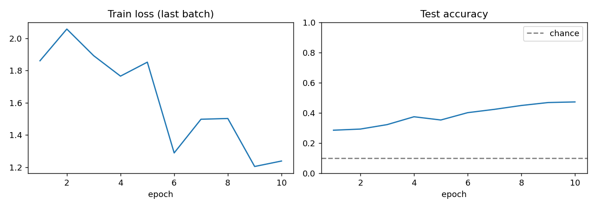
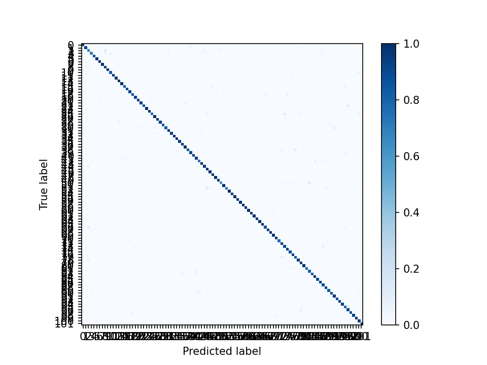
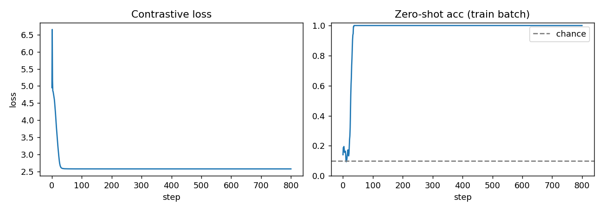
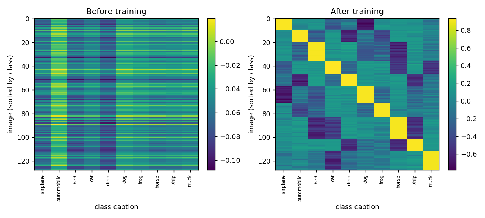
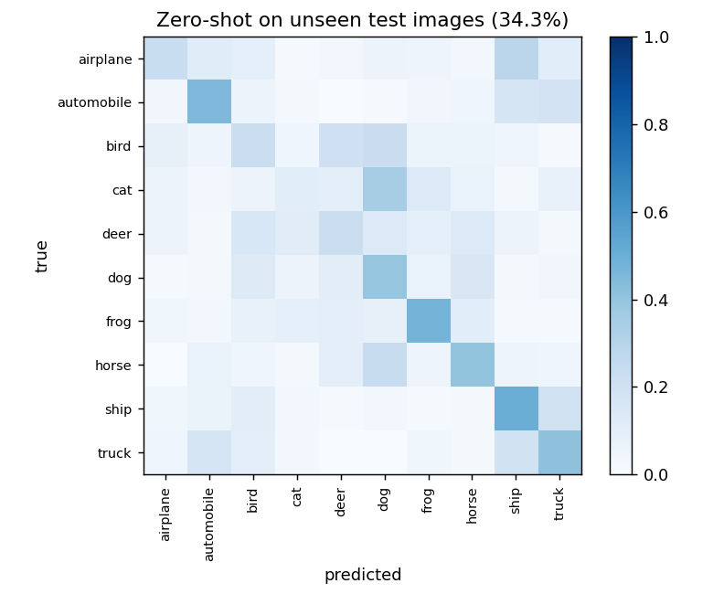

# Computer Vision from scratch

My notes and code for learning deep learning in computer vision. Every project is one small file, with a picture of what it does and the result I got.

**Run anything from the repo root:** `uv run python scripts/<file>.py`
(Setup once: `uv sync`. Scripts use CUDA, then Apple MPS, then CPU.)

## At a glance

| # | Project | File | One-line result |
| --- | --- | --- | --- |
| 1 | Vision Transformer | [`scripts/vit.py`](scripts/vit.py) | 47% test accuracy on CIFAR-10 after 10 epochs on 10k images |
| 2 | ResNet internals | [`notebooks/resnet.ipynb`](notebooks/resnet.ipynb) | Blocks built by hand, Conv+BN fusion for faster inference |
| 3 | Transfer learning | [`scripts/cnn.py`](scripts/cnn.py) | Pretrained ResNet-18 fine-tuned on Flowers-102, strong diagonal confusion matrix |
| 4 | CLIP from scratch | [`scripts/clip.py`](scripts/clip.py) | 100% zero-shot on the one batch it memorized, 34% on unseen images |
| 5 | Multimodal LLM | [`scripts/multimodal_llm.py`](scripts/multimodal_llm.py) | Architecture only, not trained yet |

---

## 1. Vision Transformer (`vit.py`)

**Idea:** cut the image into patches, treat each patch like a word, and run a transformer.

```
32x32 image ─► 64 patches (4x4) ─► linear ─► [CLS] + patches + position ─► 4 x Transformer block ─► CLS ─► 10 classes
```

**How I built it**
- `PatchEmbed`: one strided `Conv2d` cuts patches and projects each to a vector.
- `Attention`: multi-head self-attention with one fused QKV layer.
- `Block`: LayerNorm, attention, LayerNorm, MLP, each with a residual.
- `ViT`: learnable `[CLS]` token and position embeddings; the CLS output feeds the classifier.
- Training: 10k train / 2k test CIFAR-10 images, `dim=128, depth=4, heads=4`, AdamW, cosine LR, 10 epochs (~3 min on a Mac).

**Result:** accuracy climbs steadily and is still rising at epoch 10. A ViT needs lots of data; 10k images is small.



---

## 2. ResNet internals (`notebooks/resnet.ipynb`)

**Idea:** a layer learns `x + f(x)` instead of `f(x)`. The skip connection lets very deep nets train.

```
x ─┬─► conv ─► BN ─► ReLU ─► conv ─► BN ─┐
   └──────────── (1x1 conv if shape changes) ─┴─► + ─► ReLU
```

**How I built it**
- Batched inference with a pretrained ResNet-50 (`inference_mode`, fp16).
- `BasicBlock` (ResNet-18/34) and `Bottleneck` (ResNet-50+).
- `make_stage` stacks blocks; only the first block downsamples.
- Conv+BatchNorm fusion by hand (`manual_fuse_conv_bn`) and with `fuse_conv_bn_eval`. Same outputs, fewer ops at inference.

---

## 3. Transfer learning (`cnn.py`)

**Idea:** reuse an ImageNet-pretrained ResNet-18 and teach it 102 flower types.

```
pretrained ResNet-18 ─► swap last layer for 102 classes
  stage 1: freeze backbone, train head only (5 epochs)
  stage 2: unfreeze all, cosine LR (15 epochs)
```

**Result:** the confusion matrix is almost a perfect diagonal, so most flowers are classified correctly. The best checkpoint is saved to `outputs/best.pt`.



Needs scikit-learn: `uv add scikit-learn`.

---

## 4. CLIP from scratch (`clip.py`)

**Idea:** put images and captions in the same space so a photo and "a photo of a cat" land close together. Then classify with **no classifier head**: pick the class whose caption is nearest.

```
image ─► CNN ─► vector ─┐
                        ├─► similarity matrix ─► symmetric cross-entropy
text  ─► Transformer ─► vector ─┘
Zero-shot: score the image against "a photo of a {class}" for all 10 classes, take the best.
```

**How I built it**
- Image encoder: 4-block CNN. Text encoder: 2-layer transformer over a tiny word-level vocabulary.
- Both outputs are L2-normalized (128-d) and scaled by a learnable temperature.
- A batch has only 10 classes, so same-class pairs all count as positives (soft targets, not the identity matrix). That is why the loss never reaches 0.
- Overfit ONE CIFAR-10 batch (128 images, 800 steps) to prove the whole pipeline works.

**Result:** 100% zero-shot accuracy on the training batch, 34.3% on 1000 unseen images (chance is 10%). It memorizes; it does not generalize. That is expected from one batch.

Loss falls and flattens; accuracy hits 100% early:



Image-vs-caption similarity. Before training: noise. After: each image lights up on its own class.



Unseen test images: better than chance, but many mistakes.



---

## 5. Multimodal LLM (`multimodal_llm.py`)

**Idea:** turn image patches into "words" a language model can read, then let it write text.

```
image ─► ViT ─► MLP projector ─► image tokens ─┐
                                               ├─► causal transformer ─► next word
text  ─► tokens ─► embedding ──────────────────┘
```

Status: forward pass and greedy `generate` only, run on random inputs. It imports `PatchEmbedding` and `ViTBlock` from `vit.py`, but `vit.py` names them `PatchEmbed` and `Block`. Fix one side before running.

---

## What to build next

Do these in order. Each one reuses the last and ends with a graph or a number.

1. **CLIP on real captions** (Flickr8k + a real tokenizer). Report image-to-text recall@1/5/10.
2. **Augmentation ablation.** Train ViT and ResNet on CIFAR-10 with and without crop/flip/mixup. Plot accuracy per epoch.
3. **Shared `train.py`.** Warmup + cosine LR, grad clipping, mixed precision, checkpoint resume. Plot LR vs loss.
4. **ViT vs CNN.** Same CIFAR-10 split at 1k, 5k, 10k, 50k images. Plot accuracy vs data size.
5. **Object detection.** Fine-tune a pretrained detector. Learn IoU, NMS, mAP. Show boxes on images.
6. **Segmentation.** Small U-Net on Oxford-IIIT Pet. Report mean IoU. Show input / mask / prediction.
7. **Self-supervised learning.** SimCLR or masked autoencoder, then a linear probe on frozen features.
8. **Generative models.** VAE, then a small diffusion model. Show sample grids over training.
9. **Train the multimodal LLM** on Flickr8k captions. Compare generated vs real captions.
10. **Interpretability.** Grad-CAM for ResNet, attention maps for ViT, accuracy vs noise/blur.

---

## Repo layout

```
scripts/     vit.py  cnn.py  clip.py  multimodal_llm.py
notebooks/   resnet.ipynb
outputs/     plots (committed) and checkpoints (git-ignored)
data/        datasets (git-ignored)
```

## References

- He et al., [Deep Residual Learning](https://arxiv.org/abs/1512.03385), 2015
- Dosovitskiy et al., [An Image is Worth 16x16 Words](https://arxiv.org/abs/2010.11929), 2020
- Radford et al., [CLIP](https://arxiv.org/abs/2103.00020), 2021
- Liu et al., [Visual Instruction Tuning (LLaVA)](https://arxiv.org/abs/2304.08485), 2023
