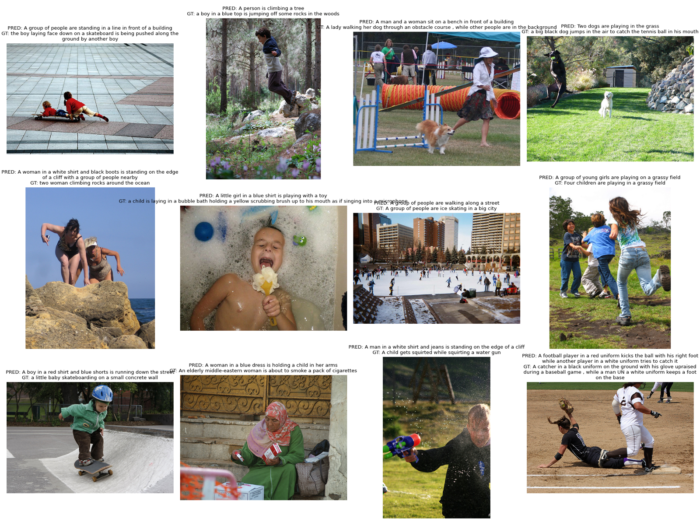
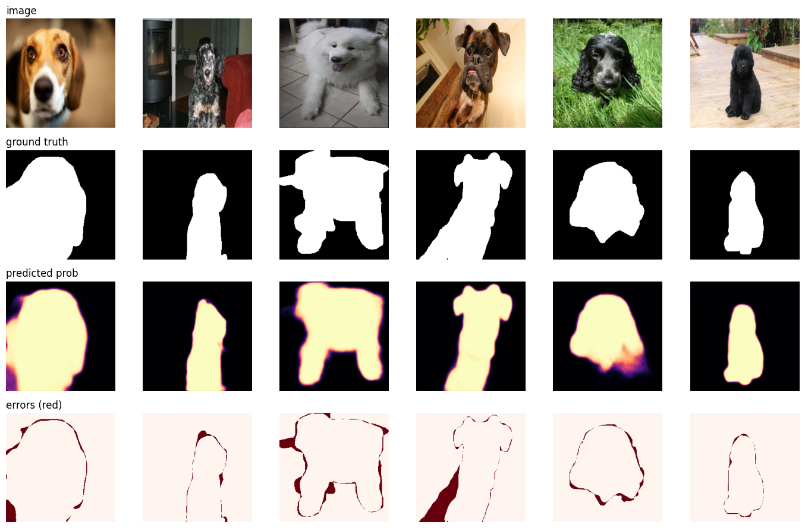
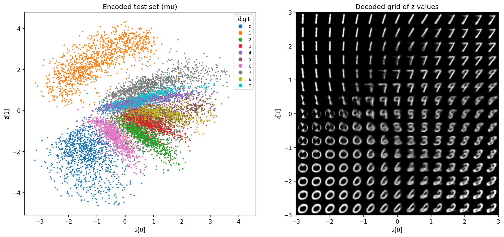

# Computer Vision from scratch

My notes and code for learning deep learning in computer vision. Each project is one script or notebook, and each has its own page in [`docs/`](docs/) with the theory, how I built it, how to run it, the plots and what I learned.

Start with the table below and click through to any project.

## Projects

| # | Project | Code | Result | Write-up |
| --- | --- | --- | --- | --- |
| 1 | Vision Transformer | [`vit.py`](scripts/vit.py) | 47% test accuracy on CIFAR-10 after 10 epochs on 10k images | [docs/01](docs/01-vision-transformer.md) |
| 2 | ResNet internals | [`resnet.ipynb`](notebooks/resnet.ipynb) | Residual blocks by hand, Conv+BN fusion for faster inference | [docs/02](docs/02-resnet-internals.md) |
| 3 | Transfer learning | [`cnn.py`](scripts/cnn.py) | Pretrained ResNet-18 fine-tuned on Flowers-102, near-diagonal confusion matrix | [docs/03](docs/03-transfer-learning.md) |
| 4 | CLIP from scratch | [`clip.py`](scripts/clip.py) | 100% zero-shot on the batch it memorized, 34% on unseen images | [docs/04](docs/04-clip.md) |
| 5 | Multimodal LLM | [`multimodal_llm.py`](scripts/multimodal_llm.py) | Flickr8k captioner with only a 1.5M projector trained: val loss 2.68 (ppl 14.5) | [docs/05](docs/05-multimodal-llm.md) |
| 6 | U-Net segmentation | [`unet_segmentation.ipynb`](notebooks/unet_segmentation.ipynb) | Pets vs background, pretrained ResNet-34 encoder: val IoU 0.911 (0.915 with flip TTA), plus inference on any photo with downloaded weights | [docs/06](docs/06-unet-segmentation.md) |
| 7 | Variational autoencoder | [`variational_encoders.ipynb`](notebooks/variational_encoders.ipynb) | MNIST VAE with a 2D latent: test loss 154.2 per image after 10 epochs (45 s on `mps`), rebuilds digits and generates new ones from N(0, 1) | [docs/07](docs/07-variational-autoencoder.md) |
| 8 | Diffusion model (DDPM) | [`ddpm.ipynb`](notebooks/ddpm.ipynb) | MNIST DDPM with a 2.94M U-Net: test noise MSE 0.0276 after 5 epochs, sharp new digits from pure noise in 1000 steps | [docs/08](docs/08-ddpm.md) |

## A quick look

| ViT on CIFAR-10 | CLIP similarity, before and after |
| --- | --- |
| [](docs/01-vision-transformer.md) | [](docs/04-clip.md) |
| **Multimodal LLM captions** | **U-Net masks and errors** |
| [](docs/05-multimodal-llm.md) | [](docs/06-unet-segmentation.md) |
| **VAE latent space** | **DDPM, noise to digit** |
| [](docs/07-variational-autoencoder.md) | [](docs/08-ddpm.md) |

## Setup

```bash
uv sync
```

Run any script from the repo root:

```bash
uv run python scripts/vit.py
```

Open a notebook:

```bash
uv run --with jupyter jupyter lab notebooks/resnet.ipynb
```

Scripts pick CUDA, then Apple MPS, then CPU. The heavier projects (multimodal LLM, U-Net) were trained on a Colab T4; their pages say how.

## Repo layout

```
scripts/     vit.py  cnn.py  clip.py  multimodal_llm.py
notebooks/   resnet.ipynb  multimodal_llm_colab.ipynb  unet_segmentation.ipynb  variational_encoders.ipynb  ddpm.ipynb
docs/        one page per project, plus TEMPLATE.md for new ones
outputs/     plots (committed) and checkpoints (git-ignored)
data/        datasets (git-ignored)
models/      downloaded pretrained weights (git-ignored)
```

## Adding a project

1. Put the code in `scripts/` or `notebooks/` and save its plots to `outputs/`.
2. Copy [`docs/TEMPLATE.md`](docs/TEMPLATE.md) to `docs/NN-short-name.md` and fill it in.
3. Add one row to the Projects table above.

## Papers behind these projects

- He et al., [Deep Residual Learning](https://arxiv.org/abs/1512.03385), 2015
- Kingma and Welling, [Auto-Encoding Variational Bayes](https://arxiv.org/abs/1312.6114), 2013
- Ronneberger et al., [U-Net](https://arxiv.org/abs/1505.04597), 2015
- Ho et al., [Denoising Diffusion Probabilistic Models](https://arxiv.org/abs/2006.11239), 2020
- Dosovitskiy et al., [An Image is Worth 16x16 Words](https://arxiv.org/abs/2010.11929), 2020
- Radford et al., [CLIP](https://arxiv.org/abs/2103.00020), 2021
- Liu et al., [Visual Instruction Tuning (LLaVA)](https://arxiv.org/abs/2304.08485), 2023

Each project page has its own, longer reference list.
