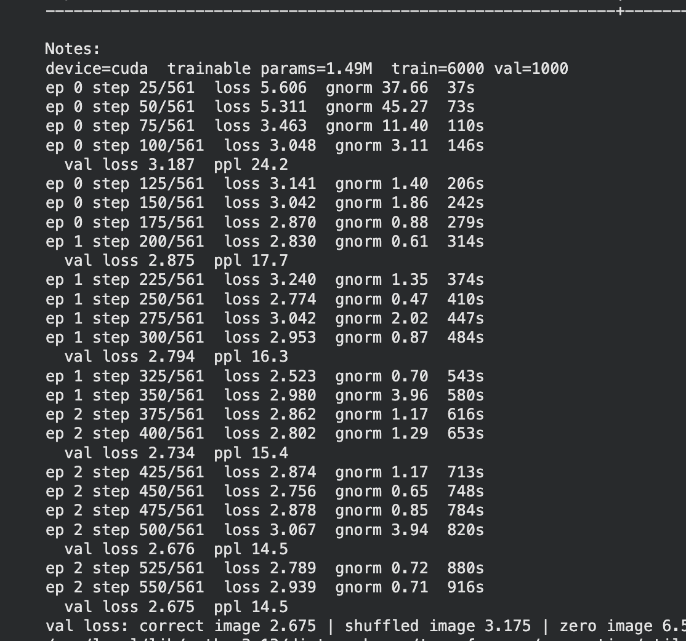
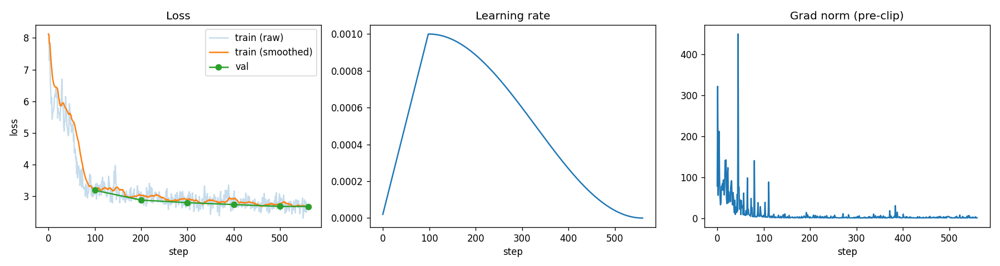

[← All projects](../README.md)

# 5. Multimodal LLM

A small image captioner in the LLaVA style. A frozen CLIP looks at the image, a frozen Qwen writes the caption, and the only thing I train is a 1.5M-parameter projector between them.

| | |
| --- | --- |
| Code | [`scripts/multimodal_llm.py`](../scripts/multimodal_llm.py), Colab: [`notebooks/multimodal_llm_colab.ipynb`](../notebooks/multimodal_llm_colab.ipynb) |
| Task | Image captioning (LLaVA stage 1, alignment) |
| Data | Flickr8k, 6000 train / 1000 val / 1000 test images, 5 captions each |
| Model | CLIP ViT-B/32 (frozen) + MLP projector (trained, 1.49M params) + Qwen2.5-0.5B-Instruct (frozen) |
| Hardware | Colab T4, 3 epochs (561 steps), about 15 minutes |
| Result | Val loss 2.675 (perplexity 14.5). Captions get the gist but get details wrong |

## The question

How does a language model "see"? I wanted to build the smallest version of a vision-language model and check that the LLM really uses the image, not just its language habits.

## Theory

**Image patches as words.** CLIP turns the image into 49 patch vectors (a 7x7 grid). If those vectors were in the LLM's embedding space, the LLM could read them like word embeddings. They are not.

**Why a projector.** CLIP's features are 768-d and live in CLIP's space. Qwen reads 896-d vectors in its own space, and the axes of the two have nothing to do with each other. The projector learns the map. Its outputs are "soft tokens": they do not match any real word. They are whatever makes the caption loss go down.

```
image ─► CLIP ViT (frozen) ─► MLP projector (trained) ─► 49 image tokens ─┐
                                                                          ├─► Qwen2.5-0.5B (frozen) ─► next word
caption ─► tokenizer ─► embedding table ──────────────────────────────────┘
```

**One training example** (image + "a dog runs on grass"):

```
input   : [I1 ... I49]  a    dog   runs  on    grass  EOS      (49 image vectors + 6 text vectors)
predict :  ...    I49   a    dog   runs  on    grass  EOS
                   │    │     │     │    │      │      │
target  :          a   dog  runs   on  grass   EOS     -
```

- Each position predicts the next token. The loss is cross-entropy against the true token IDs.
- Image positions and padding get label -100, so only caption tokens count.
- Teacher forcing: training feeds the true previous words, so one forward pass gives every prediction. At generation time the model feeds back its own words one at a time.
- Gradients pass through the frozen Qwen into the projector, the only part that updates.
- Each image has 5 captions and a random one is picked every step. The model learns what they share ("dog", "grass", "running"). This is also why the loss can never reach 0.

## How I built it

- CLIP ViT-B/32 patch tokens (CLS dropped), frozen. Since vision is frozen, I compute CLIP features once and cache them to disk.
- Projector: 2-layer MLP, 768 → 896 → 896.
- Qwen2.5-0.5B-Instruct, frozen.
- AdamW, lr 1e-3, 100 warmup steps then cosine decay, grad clip 1.0, batch 32, 3 epochs.
- Generation: beam search (3 beams), repetition penalty 1.2.
- Evaluation: val loss, two ablations (shuffled images, zero images), BLEU-4 (my own implementation), and a grid of sample captions.

## Run it

Colab (recommended, T4): upload [`notebooks/multimodal_llm_colab.ipynb`](../notebooks/multimodal_llm_colab.ipynb), set the runtime to T4 GPU, run all. It downloads the models and data and saves the plots and `projector.pt`.

Locally, sanity check first (loss should fall toward 0), then the real run:

```bash
uv run python scripts/multimodal_llm.py --overfit
```

```bash
uv run python scripts/multimodal_llm.py
```

On a Mac with MPS this is much slower than a T4.

## Results

Training log from the Colab run:



| Check | Value | Meaning |
| --- | --- | --- |
| Val loss, correct image | **2.675** (perplexity 14.5) | about as unsure as picking among 14 words per step |
| Val loss, shuffled images | 3.175 | images swapped between captions is worse, so the image is used |
| Val loss, zero image | above 6 (log cut off at 6.5) | no image is far worse |
| Test BLEU-4 | not recorded | cut off in the log; rerun to get it |
| Speed | ~1.6 s/step on T4 | 561 steps in about 15 min |



- **Loss** drops from about 8 to 3 in the first 100 steps (the model learns caption style and starts using the image), then creeps from 3.2 to 2.68. Train and val track each other, so there is no overfitting. The limit is capacity: only the projector learns.
- **Learning rate** warms up linearly to 1e-3 over 100 steps, then decays to 0.
- **Grad norm** (before clipping) is huge at the start, up to 450, while the projector is random. It settles near 1. Warmup and clipping kept training stable.

Sample captions on validation images (PRED is the model, GT is one human caption):


- It gets the gist: "Two dogs are playing in the grass", "A group of young girls are playing on a grassy field".
- It misses details and actions. A toddler skateboarding in a blue helmet becomes "a boy in a red shirt running down the street". A baseball slide becomes a football kick. Ice skaters are "walking along a street". Colors and counts are often wrong.
- Wording is generic. Many captions start "A group of people are...". That is typical when the LLM stays frozen.

## What I learned

- The ablations are the real proof. Shuffled images cost 0.5 nats, zero images cost far more, so the model does read the image.
- That 0.5-nat gap is also a warning: much of the loss is still the language prior.
- A frozen LLM reading soft tokens it has never seen can only give coarse captions. To get details right, the LLM itself has to adapt.

## Next (stage 2)

1. LoRA on Qwen's attention layers so the LLM adapts to image tokens.
2. Instruction data in Qwen's chat format (`user: [image] question -> assistant: answer`), with the prompt masked out of the loss.
3. Compute logits only on answer positions to save memory and time.
4. Use CLIP's penultimate-layer features, as LLaVA does.
5. Check object hallucination with yes/no questions ("Is there a dog?").

## References

- Liu et al., [Visual Instruction Tuning (LLaVA)](https://arxiv.org/abs/2304.08485), 2023
- Radford et al., [CLIP](https://arxiv.org/abs/2103.00020), 2021
- Qwen Team, [Qwen2.5 Technical Report](https://arxiv.org/abs/2412.15115), 2024
