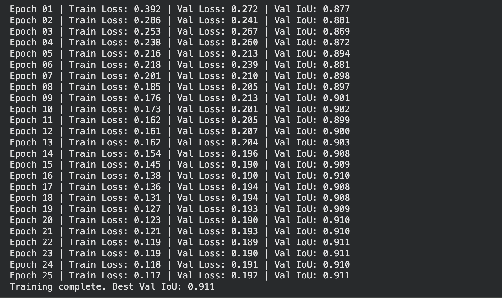
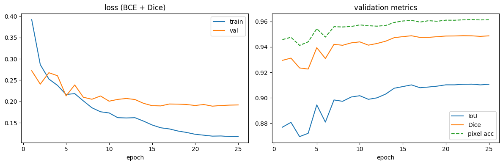
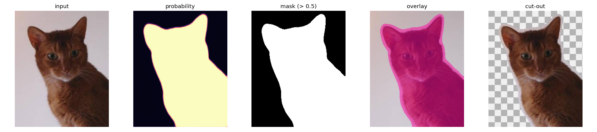
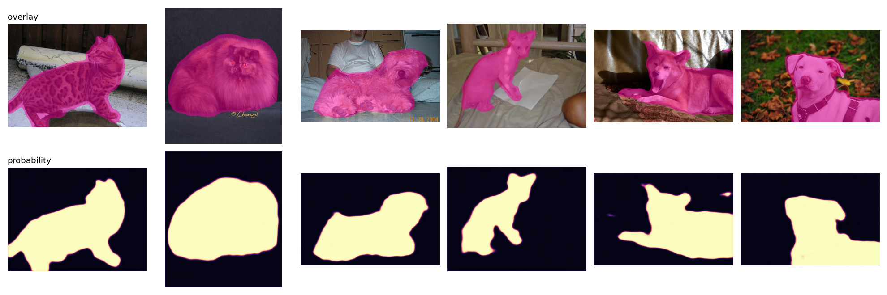

[← All projects](../README.md)

# 6. U-Net segmentation

Cut pets out of photos, pixel by pixel. I first built a U-Net from scratch, then swapped in a pretrained encoder, and that one change moved val IoU from 0.818 to 0.911.

| | |
| --- | --- |
| Code | [`notebooks/unet_segmentation.ipynb`](../notebooks/unet_segmentation.ipynb) |
| Task | Binary segmentation: pet vs background |
| Data | Oxford-IIIT Pet, 3680 train / 400 val images, 256x256 |
| Model | U-Net with an ImageNet-pretrained ResNet-34 encoder (`segmentation_models_pytorch`) |
| Hardware | Google Colab, Tesla T4, 25 epochs |
| Result | Val IoU 0.911, Dice ~0.95, pixel accuracy ~0.96. Flip TTA: IoU 0.915 |

## The question

Classification gives one label per image. Segmentation gives one label per pixel, so the output is a mask the same size as the input. I wanted to know how a U-Net keeps sharp edges when it has to shrink the image to understand it, and how much a pretrained backbone helps on a small dataset.

## Theory

**Why a U shape.** A plain CNN shrinks the image as it goes deeper. Deep layers know *what* is in the picture (a dog) but have lost *where* exactly the edges are. U-Net (Ronneberger et al., 2015) fixes this with two halves and a bridge:

- The **encoder** goes down. Each step halves the size and doubles the channels.
- The **decoder** goes back up with transposed convolutions until the mask is full size again.
- **Skip connections** copy encoder features at each size straight across to the decoder. The decoder gets the "what" from below and the sharp "where" from the side.

```
input ─► enc1 ──────────────────────────────── skip ──► dec1 ─► 1x1 conv ─► mask
           │ pool                                          ▲ up
           enc2 ───────────────────────── skip ──► dec2 ───┘
             │ pool                                  ▲ up
             enc3 ─────────────────── skip ──► dec3 ─┘
               │ pool                            ▲ up
               enc4 ───────────── skip ──► dec4 ─┘
                 │ pool                      ▲ up
                 └──────► bottleneck ────────┘
```

Remove the skips and the masks turn into soft blobs. That is the easiest way to convince yourself they matter (exercise 4 in the notebook).

**Labels.** The dataset masks are trimaps: `1 = pet`, `2 = background`, `3 = border`. I count the border as pet, so the task is binary. The image and its mask must get the same flip, crop and rotation. `torchvision.transforms.v2` handles that when the mask is a `tv_tensors.Mask`. Masks are resized with nearest interpolation, because bilinear would invent labels like 0.5.

**Loss: BCE + Dice.**
- BCE scores every pixel on its own. Gradients are smooth, but if most pixels are background the model can score well by mostly saying "background".
- Dice loss is `1 - 2|P∩G| / (|P| + |G|)`. It looks at overlap of the whole mask, so class imbalance does not fool it. Alone its gradients are noisy.
- Adding them is the standard recipe: BCE for stable per-pixel learning, Dice to push overlap.

**Metrics.**
- Pixel accuracy is easy to read and easy to fool. A model that predicts all background on an image that is 5% pet gets 95%.
- IoU is `|P∩G| / |P∪G|`. This is the number I trust.
- Dice is `2|P∩G| / (|P| + |G|)`, the F1 score of pixels. It is always at least as high as IoU.

**Why a pretrained encoder helps so much.** 3680 images is not many. A ResNet-34 trained on ImageNet already knows edges, fur, eyes and object shapes. The decoder only has to learn how to turn those features into a mask. It is the same idea as [transfer learning](03-transfer-learning.md), applied to dense prediction.

## How I built it

1. **Blocks by hand.** `DoubleConv` (two conv-BN-ReLU), `Down` (maxpool + DoubleConv) and `Up` (ConvTranspose + concat skip + DoubleConv), then a `UNet` class that stacks them. These are still in the notebook so you can see how the pieces fit.
2. **First run, from scratch.** My hand-built U-Net (7.8M params), 128px, 2000 train images, 12 epochs on a Mac (MPS). Val IoU 0.818, 0.822 with flip TTA. Errors were thin lines on edges plus blobs on background that looked furry (sunflowers, a wooden fence).
3. **Second run, pretrained encoder.** `smp.Unet("resnet34", encoder_weights="imagenet", classes=1)`. I also raised the resolution to 256px, used all 3680 trainval images, trained 25 epochs and added stronger augmentation. This is the run in the notebook now.

Training setup for the current run:
- Augmentation: `RandomResizedCrop(256, scale=(0.5, 1.0))`, horizontal flip, rotation up to 15°, color jitter (image only).
- ImageNet mean/std normalization, batch size 16.
- AdamW, lr 3e-4, weight decay 1e-4, cosine schedule stepped every batch.
- Keep the checkpoint with the best val IoU.

After training I measured inference speed (batch size, fp16, `channels_last`) and two free accuracy tricks: flip test-time augmentation and a threshold sweep.

4. **Inference with downloaded weights (section 11).** My Colab weights were never saved to disk, so I downloaded a trained U-Net from the Hugging Face Hub instead: [`Zahro22/oxford-pet-segmentation`](https://huggingface.co/Zahro22/oxford-pet-segmentation). It has the same architecture as run 2 (`smp.Unet`, ResNet-34 encoder, 1 class), was trained on the same dataset, and reports test IoU 0.919. I load it two ways: with `smp.from_pretrained`, and by hand with `smp.Unet(...)` + `load_state_dict` on the `.safetensors` file. Both give the same output. Then a `segment(path)` function takes any photo and returns a probability map and a mask at the photo's original size.

## Run it

Colab with a T4 GPU is the easiest. Upload the notebook, pick the GPU runtime and run all. The first cell installs `segmentation-models-pytorch` and `albumentations`.

Locally:

```bash
uv run --with jupyter --with segmentation-models-pytorch jupyter lab notebooks/unet_segmentation.ipynb
```

The dataset (~800 MB) downloads to `data/` on the first run.

To only run inference, skip to section 11. It needs no training and runs on a Mac in about 20 seconds. The weights (98 MB) download to `models/unet-resnet34-oxford-pet/`. To segment your own photo, set `IMAGE = "path/to/photo.jpg"` in the "Try it" cell.

## Results

### Training





- Val IoU starts at 0.877 after one epoch. That head start is the pretrained encoder; the scratch model needed all 12 epochs to reach 0.818.
- Val loss flattens around 0.19 after epoch 15 while train loss keeps falling to 0.117. The gap is small and IoU holds at 0.91, so it is mild overfitting, not a problem yet. Training past 25 epochs would not buy much.
- The early bumps (epochs 3, 4, 6) come from the high learning rate at the start of the cosine schedule.

### Predictions

Rows: input, ground truth, predicted probability, and pixels that are wrong (red).


- Most errors are now thin lines along the outline, where the trimap border is fuzzy anyway.
- The worst miss is the boxer (4th column). Its brown body against a brown wall gets cut off at the lower left.
- The spaniel in the grass (5th) loses some chest fur, which fades into the dark background. The probability map shows the model is unsure there, not confidently wrong.
- The furry-background blobs from the scratch model are gone. Pretrained features know what a pet looks like as a whole.

### Before vs after

| Run | Encoder | Image size | Train images | Epochs | Val IoU | IoU + flip TTA |
| --- | --- | --- | --- | --- | --- | --- |
| 1 | random init (7.8M U-Net) | 128 | 2000 | 12 | 0.818 | 0.822 |
| 2 | ResNet-34, ImageNet | 256 | 3680 | 25 | **0.911** | **0.915** |

### Inference tricks

| Check | Result |
| --- | --- |
| fp32 vs fp16 IoU | 0.9107 vs 0.9107, no loss |
| Flip TTA | 0.9107 → 0.9146 |
| Threshold sweep (0.3 to 0.7) | 0.5 is best (0.9146); 0.4 is close at 0.9135 |

Speed on a T4 at 256px:

| Setting | Batch | ms / batch | images / s |
| --- | --- | --- | --- |
| fp32 | 1 | 15.8 | 63 |
| fp32 | 64 | 255.4 | 251 |
| fp16 | 1 | 6.6 | 151 |
| fp16 | 64 | 129.0 | 496 |
| fp16 + channels_last | 64 | 108.7 | 589 |

fp16 is free accuracy-wise and doubles speed on the T4's tensor cores. `channels_last` adds another ~19% on top. Batch 1 is what a phone app cares about (latency). Batch 64 is what a server chewing through a folder cares about (throughput). On my Mac (first run) fp16 only helped at batch 1, so these numbers depend a lot on the device.

### Inference with downloaded weights

The model card does not say how images were normalized during training, so I tested four options on 100 labelled test images:

| Preprocessing | IoU |
| --- | --- |
| `(x/255 - mean) / std`, the ImageNet normalization I trained with | 0.000 |
| `x/255` | 0.000 |
| `x`, raw 0..255 | 0.886 |
| `(x - mean) / std` on 0..255, as in the smp tutorial | **0.911** |

The "correct" ImageNet normalization gives zero: the model calls every pixel background. These weights were trained with mean and std subtracted from 0..255 pixels, and inference has to copy that. Nothing crashes when the preprocessing is wrong. You only get bad masks.

One photo, end to end (input, probability, mask, overlay, cut-out with a transparent background):





- The masks spread a few pixels past the fur, so the cut-out keeps a thin halo of background. That comes from the labels: the trimap border class counts as pet, so the model learned to paint the border band too.
- The man in the third photo is ignored. The model learned "pet", not "whatever is in front".
- In the fifth photo the dark animal behind the dog is mostly missed, and there is a small false blob at the top right.

## What I learned

- The encoder matters more than anything I did to the loss or the decoder. On small data, start pretrained.
- Pixel accuracy (0.96) looks great and says little. IoU is where the real gaps show.
- Always re-check accuracy after a speed trick. Here fp16 was free; that is not guaranteed.
- TTA and threshold tuning are cheap to try. The threshold sweep must use validation data, never test.
- A trained model is architecture plus weights, and the preprocessing belongs to the weights. When I load weights I did not train, I check them on a few labelled images before trusting them.
- Save the weights at the end of a Colab run (`model.save_pretrained(...)`). RAM is gone when the runtime stops.
- Prefer `.safetensors` over `.pth` for downloaded weights. A `.pth` is a pickle and can run code when loaded.

## Next

- Boundary-aware loss (or Lovász) to clean up the edge lines.
- Three classes (pet / background / border) with cross-entropy.
- Try a stronger encoder (ConvNeXt, EfficientNet) or a transformer segmenter like SegFormer.
- Compare against SAM 2 zero-shot with a box prompt.
- Export to ONNX / CoreML and time it on the Mac.

## References

- Ronneberger et al., [U-Net: Convolutional Networks for Biomedical Image Segmentation](https://arxiv.org/abs/1505.04597), 2015
- Isensee et al., [nnU-Net](https://arxiv.org/abs/1809.10486), 2018
- Xie et al., [SegFormer](https://arxiv.org/abs/2105.15203), 2021
- [segmentation_models.pytorch](https://github.com/qubvel-org/segmentation_models.pytorch)
