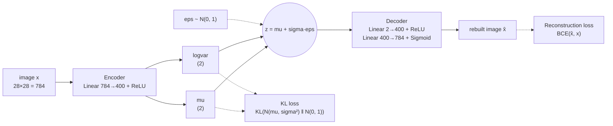
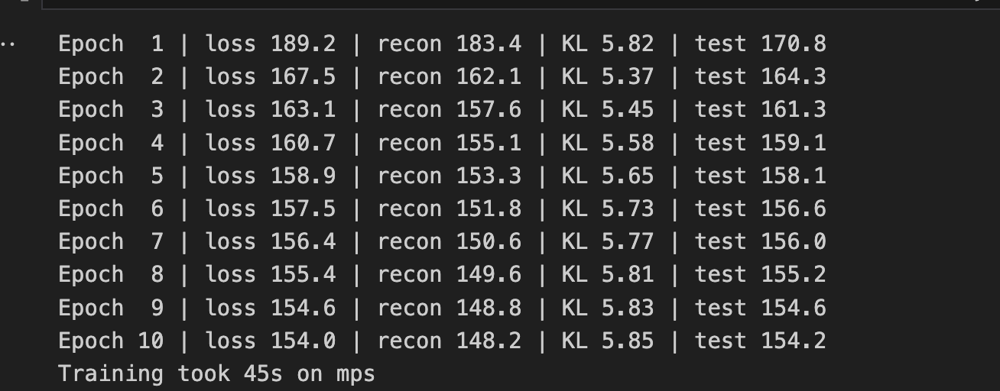
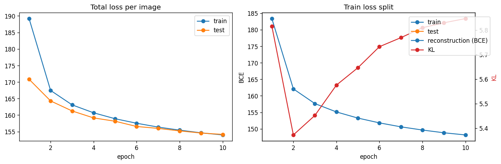
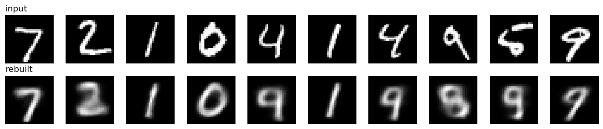
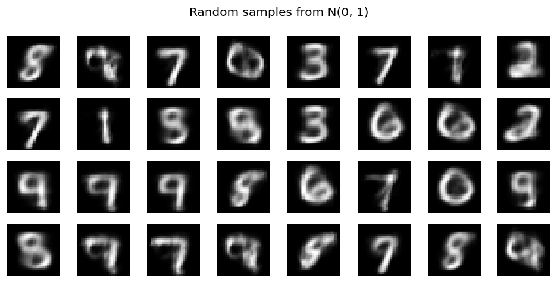
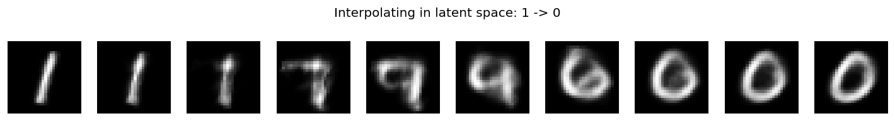
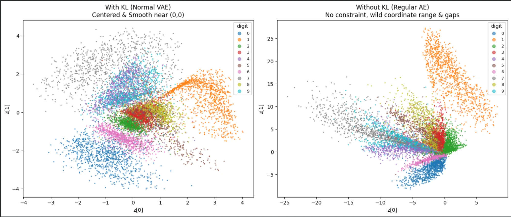

[← All projects](../README.md)

# 7. Variational autoencoder (VAE)

A small VAE on MNIST, built from plain linear layers. It squeezes each digit into just 2 numbers, rebuilds it, and can draw brand new digits from random noise.

| | |
| --- | --- |
| Code | [`notebooks/variational_encoders.ipynb`](../notebooks/variational_encoders.ipynb) |
| Task | Generative modelling: learn to rebuild and generate handwritten digits |
| Data | MNIST, 60000 train / 10000 test images, 28x28 grayscale |
| Model | MLP VAE, 784 → 400 → 2 → 400 → 784, 631k params, trained from scratch |
| Hardware | Apple Silicon GPU (`mps`), 10 epochs, 45 s |
| Result | Test loss 154.2 per image after 10 epochs (train split: BCE 148.2 + KL 5.85) |

## The question

Every model so far in this repo takes an image and outputs a label, a mask or a caption. I wanted to build one that goes the other way and *makes* images. A VAE is the simplest real generative model, and it is also the piece Stable Diffusion uses to compress images before diffusion runs. So I wanted to understand three things: why a plain autoencoder can't generate, what the "variational" part adds, and what the latent space actually looks like.

## Theory

### Start with a plain autoencoder

An autoencoder has two halves. The **encoder** squeezes an image into a short vector `z` (the latent code). The **decoder** turns `z` back into an image. Train it so output ≈ input.

```
         ENCODER                     DECODER
image ──► 784 ─► 400 ─► z (2 numbers) ─► 400 ─► 784 ──► rebuilt image
 28x28                  "bottleneck"                       28x28
```

Because `z` is tiny, the network can't just copy pixels. It has to learn what matters about a digit.

The problem: nothing tells the encoder *where* to put codes. It might put all the 1s at `(40, -7)` and all the 0s at `(-3, 90)`, with empty space everywhere else. Pick a random `z`, decode it, and you usually land in that empty space and get noise. A plain autoencoder can copy, but it can't generate.

### The VAE fix: encode to a cloud, not a point

A VAE changes two things.

1. The encoder outputs a **Gaussian** for each image: a mean `mu` and a spread `sigma`. The code `z` is a random sample from that Gaussian. The same image gives slightly different `z` each time, so the decoder must handle a small neighbourhood around each code, not one exact point.
2. A second loss term, the **KL divergence**, pulls every one of those Gaussians toward the standard normal `N(0, 1)`. All the clouds get packed into the same region around the origin, with no big gaps.

```
   Plain autoencoder                     VAE
   (points, gaps between)                (overlapping clouds near 0)

     1 •                                    ╭───╮
              • 0                        ╭──┤ 1 ├──╮
                                         │0 ╰───╯ 7│
   • 7          ?  ← decode here           ╰──╮ 3 ╭──╯
                     = garbage                ╰───╯
                                          any z ~ N(0,1) decodes
                                          to something digit-like
```

After training, the space is smooth and filled in. Sample `z ~ N(0, 1)`, decode it, and you get a digit. That is the whole trick.

### The full architecture



The encoder predicts `logvar = log(sigma²)` rather than `sigma`. Any real number is a valid `logvar`, so the layer needs no special activation, and `sigma = exp(0.5 · logvar)` is always positive.

### The reparameterization trick

Sampling is random, and you can't backpropagate through "pick a random number". The fix is to move the randomness out of the way:

```
  Can't train:                       Can train:

  mu, sigma ──► [ sample z ] ──► z     eps ~ N(0,1)  (no gradient needed)
                  ✗ no gradient              │
                                              ▼
                                   mu ──► z = mu + sigma · eps ──► decoder
                                   sigma ──┘   ✓ plain math, gradients flow
```

`eps` is just noise from outside the network. `z` is now an ordinary sum and product of `mu` and `sigma`, so gradients flow back into the encoder. In code it is three lines:

```python
std = torch.exp(0.5 * logvar)
eps = torch.randn_like(std)
z = mu + std * eps
```

### The loss

$$
\mathcal{L} = \underbrace{\text{BCE}(\hat{x}, x)}_{\text{rebuild well}}
\;+\; \underbrace{-\tfrac{1}{2}\sum_{j}\left(1 + \log\sigma_j^2 - \mu_j^2 - \sigma_j^2\right)}_{\text{KL: stay close to } N(0,1)}
$$

- **Reconstruction (BCE).** Pixels are in `[0, 1]` and the decoder ends in a sigmoid, so binary cross-entropy per pixel fits. I sum over the 784 pixels.
- **KL.** For two Gaussians the KL has the closed form above, no sampling needed. It is zero only when `mu = 0` and `sigma = 1`. Moving `mu` away from 0 costs `mu²`. Shrinking `sigma` toward 0 costs `-log sigma²`, which blows up, so the encoder can't collapse back to plain points.

The two terms fight. Reconstruction wants every image to get its own sharp, separate code. KL wants every code to look the same, `N(0, 1)`. The model settles on codes that are spread out just enough to tell digits apart and packed just enough to leave no holes.

Where the formula comes from, in one line: we want to maximise `log p(x)`, which is intractable, so we maximise a lower bound on it instead, the **ELBO** (evidence lower bound) = reconstruction term − KL term. Minimising the loss above is the same as maximising the ELBO.

### Why the images are blurry

VAE samples look soft. Two reasons. With BCE (or MSE) loss, when the model is unsure whether a stroke goes left or right, the cheapest answer is the average, which is a blur. And with only 2 latent numbers there is not much room for detail. A bigger latent helps a lot. Sharper generators (GANs, diffusion) avoid the averaging problem in other ways.

## How I built it

1. **Data.** `torchvision.datasets.MNIST` with `ToTensor()`, which scales pixels to `[0, 1]`. Batch size 128.
2. **Model.** One `VAE` class with `encode`, `reparameterize`, `decode` and `forward`. Encoder: `Linear(784, 400)` + ReLU, then two heads `Linear(400, 2)` for `mu` and `logvar`. Decoder: `Linear(2, 400)` + ReLU, `Linear(400, 784)` + sigmoid. 631,188 parameters.
3. **Latent size 2.** On purpose. It makes reconstructions worse but lets me plot the latent space directly with no PCA or t-SNE.
4. **Loss.** `vae_loss` returns total, BCE and KL separately so I can watch both parts.
5. **Training.** Adam, lr 1e-3, 10 epochs, no augmentation, no schedule. Test loss computed after each epoch with the same formula.
6. **Inspection.** Reconstructions, random samples from `N(0, 1)`, the encoded test set coloured by label, a decoded grid over `z ∈ [-3, 3]²`, and a straight-line walk from a 1 to a 0.
7. **Ablation: drop the KL term.** Train the same network with reconstruction loss only, which makes it a plain autoencoder, and plot both latent spaces side by side.

## Run it

```bash
uv run --with jupyter jupyter lab notebooks/variational_encoders.ipynb
```

MNIST (~50 MB) downloads to `data/` on the first run. Plots are saved to `outputs/vae_*.png`. It runs fine on a laptop; no GPU needed.

## Results

### Training

10 epochs took 45 s on the Mac's `mps` GPU. All losses are per image, summed over 784 pixels.



| Epoch | Train loss | Recon (BCE) | KL | Test loss |
| --- | --- | --- | --- | --- |
| 1 | 189.2 | 183.4 | 5.82 | 170.8 |
| 2 | 167.5 | 162.1 | 5.37 | 164.3 |
| 3 | 163.1 | 157.6 | 5.45 | 161.3 |
| 4 | 160.7 | 155.1 | 5.58 | 159.1 |
| 5 | 158.9 | 153.3 | 5.65 | 158.1 |
| 6 | 157.5 | 151.8 | 5.73 | 156.6 |
| 7 | 156.4 | 150.6 | 5.77 | 156.0 |
| 8 | 155.4 | 149.6 | 5.81 | 155.2 |
| 9 | 154.6 | 148.8 | 5.83 | 154.6 |
| 10 | 154.0 | 148.2 | 5.85 | 154.2 |



How to read it: the left plot is total loss per image for train and test. The right plot splits the train loss into reconstruction (BCE, left axis) and KL (right axis). Ignore the extra "train" and "test" entries in the right legend; that is a plotting leftover, not real lines.

What I see:

- **No overfitting.** Test loss is *below* train loss in early epochs. That is normal: train loss is averaged over the whole epoch, including the bad first batches, while test loss is measured at the end. By epoch 9 the two lines meet (154.6 vs 154.6) and stay together.
- **Reconstruction does most of the work.** BCE drops from 183.4 to 148.2. KL is tiny next to it, between 5.37 and 5.85.
- **KL dips, then climbs.** It falls from 5.82 to 5.37 in epoch 2, then rises every epoch to 5.85. My reading: at first the KL term wins and squeezes codes toward `N(0, 1)`. Once the decoder gets useful, the encoder spreads codes out again to carry more information, and pays a bit more KL for it. This is the tug of war from the theory section, showing up in the numbers.
- **Still improving at epoch 10.** Both curves are flattening but not flat. More epochs would help a little; a bigger latent would help a lot more.

### Reconstructions

Top row: real test digits. Bottom row: the VAE's rebuild from only 2 numbers.



- **Clean:** the 7, both 1s and the 0. These are simple shapes that sit in their own corner of the latent space (see below).
- **Right digit, blurry:** the 2. You can tell what it is, but the strokes are smeared.
- **Wrong digit:** both 4s come back as 9s, the 5 comes back as a 9, and the first 9 comes back looking like an 8. The last 9 is faint and drifts toward a 7.

Two numbers is not enough room to keep 4 and 9 apart, or 5 apart from its neighbours. The decoder picks the most "average" digit for that spot in latent space. The latent plot below shows exactly why.

### New digits from random noise

No input image. Sample `z ~ N(0, 1)`, decode it.



Most of the 32 samples read as real digits: plenty of 7s, 9s, 3s, 8s and 6s, plus a 0, a 1 and two 2s. All of them are soft, as expected. A handful are mush, for example the top row's second and fourth tiles and the bottom row's last tile. Those are points that land between clusters, so the decoder draws a blend of 0, 6 and 4. There are almost no clear 4s or 5s, which matches the reconstruction failures above.

### The latent space

Left: the `mu` of every test image, coloured by its true digit. The model never saw the labels. Right: decode a 15×15 grid of `z` values from -3 to 3. Each tile sits at the `z` that produced it, so the two plots line up.


Left plot:

- **1s are on their own island** in the top left, well away from everything else. That is why 1s rebuild perfectly.
- **0s own the bottom left**, with 6s right next to them. Round digits sit together.
- **7, 9 and 4 form one long band** across the middle. 4 and 9 sit almost on top of each other.
- **2, 3, 5 and 8 pile up in the centre** and overlap heavily.
- The whole cloud is roughly centred on the origin and mostly inside -3 to 3, which is what the KL term asks for. Some 0s and 1s reach out to about ±4.

Right plot:

- Moving left to right along the top, a straight 1 slowly leans over and grows a top bar into a 7. One axis has learned something like slant.
- Moving down the left edge, 1 turns into a broken loop and then a clean 0.
- Along the bottom, 0 turns into 6 and then 2.
- The centre right is a mix of 3, 5 and 8.
- **There is almost no 4 anywhere on the grid.** The 4 and 9 region decodes as 9. The decoder only has one picture for that spot, and 9 wins.

### Walking from a 1 to a 0

Encode a real 1 and a real 0, then decode 10 points on the straight line between their codes.



The ends are clean: two 1s on the left, two 0s on the right. The middle is not a smooth fade. The path cuts through other digits' regions: the 1 gets a top bar and becomes a rough 7, then a 9, then a 6, then a 0 with a stroke inside it, then a clean 0. Steps 4 to 6 are blurry and only half look like digits. That is what you expect from a 2D latent where the line from the 1 island to the 0 corner has to cross the crowded middle.

### With and without the KL term

The theory section claims the KL term is what makes a VAE able to generate. To check it, I trained the same network twice: once with the full loss (BCE + KL), once with BCE only. Without KL, the model is a plain autoencoder. Both plots show the encoded test set, coloured by digit.



Note that the left plot is a fresh VAE run, so its layout differs from the latent plot above (here the 1s are on the right, not the top left). The digits land somewhere new each run. What stays the same is the shape and scale of the cloud.

| | With KL (VAE) | Without KL (plain AE) |
| --- | --- | --- |
| `z[0]` range | about -3.7 to 4 | about -24 to 8 |
| `z[1]` range | about -4 to 4.4 | about -8 to 27 |
| Centre | near (0, 0) | dense knot near (0, 0), long arms going out |
| Shape | one round cloud, clusters touch | thin spokes fanning out, big empty areas between them |

What I see:

- **Scale.** With KL, everything sits inside roughly ±4, the same range as `N(0, 1)`. Without KL, the codes stretch to 27 on one axis and -24 on the other, about 6 times wider. Nothing tells the encoder to stay small, so it doesn't.
- **Shape.** The AE's codes form spokes. The 1s shoot straight up to about 27, the 7s trail off to the left past -20, and the 0s point down. Each digit gets its own direction, and the distance from the centre seems to carry the rest of the information.
- **Gaps.** The AE plot has large empty regions, for example the whole top-left corner and everything to the right of the 1s. The VAE plot has no big holes. Its clusters sit right next to each other.
- **Why this breaks generation.** Sampling `z ~ N(0, 1)` only covers about -2 to 2 on each axis. On the VAE that box covers most digits. On the AE it only hits the crowded knot near the origin, where 0, 2, 3, 6 and 8 pile up, and misses the 1s and 7s entirely. Go further out and you land in empty space that the decoder never trained on.

Both models can rebuild their inputs. Only the one with KL gives a latent space you can sample from. That is the whole point of the "variational" part, and this plot shows it more clearly than the formula does.

## What I learned

- A plain autoencoder is a compressor, not a generator. The KL term is what turns it into a generator, by forcing the latent space to have no holes. Removing it showed this directly: the codes spread from ±4 out to about 27, in thin spokes with big gaps between them.
- The reparameterization trick is a small rewrite, `z = mu + sigma · eps`, but without it the encoder gets no gradient at all.
- Predict `logvar`, not `sigma`. No constraint on the output, and `exp` keeps `sigma` positive.
- The two loss terms pull in opposite directions, and the balance between them is the model. Logging them separately makes that visible.
- The model never sees labels, yet digits cluster by class in latent space. Similar-looking digits (4 and 9, 3 and 5 and 8) end up as neighbours.
- With only 2 latent numbers, neighbours turn into the same digit. Every 4 I fed in came back as a 9, and the decoded grid has almost no 4 in it. The latent plot predicted the failure before I looked at the reconstructions.
- Blurry samples are expected from a VAE with pixel-wise loss, not a bug.

## Next

1. Raise `latent_dim` to 16 or 32. Much sharper reconstructions; use t-SNE to look at the space.
2. Conv encoder and decoder, then try FashionMNIST or CelebA faces.
3. **beta-VAE.** Multiply the KL by `beta`. `beta > 1` gives smoother, more disentangled axes (one axis = slant, another = thickness). `beta < 1` gives sharper images and a messier space.
4. **Conditional VAE.** Feed the digit label to the encoder and decoder, then ask for "a 7" on demand.
5. Read how Stable Diffusion's VAE compresses 512×512 images to a 64×64×4 latent, and why diffusion is run there instead of on pixels.

## References

- Kingma and Welling, [Auto-Encoding Variational Bayes](https://arxiv.org/abs/1312.6114), 2013
- Doersch, [Tutorial on Variational Autoencoders](https://arxiv.org/abs/1606.05908), 2016
- Higgins et al., [beta-VAE](https://openreview.net/forum?id=Sy2fzU9gl), 2017
- Rombach et al., [High-Resolution Image Synthesis with Latent Diffusion Models](https://arxiv.org/abs/2112.10752), 2022
- PyTorch examples, [VAE on MNIST](https://github.com/pytorch/examples/tree/main/vae)
