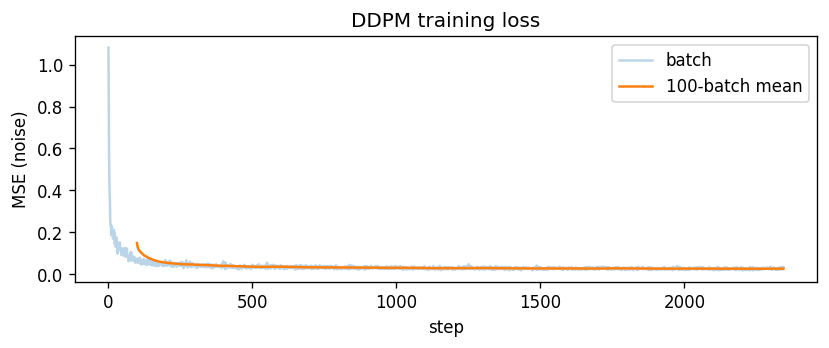
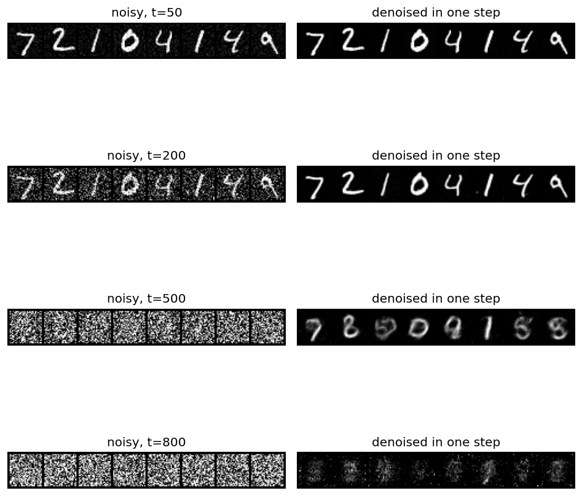
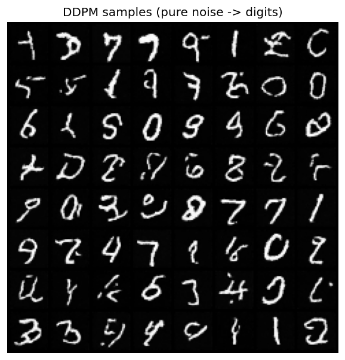
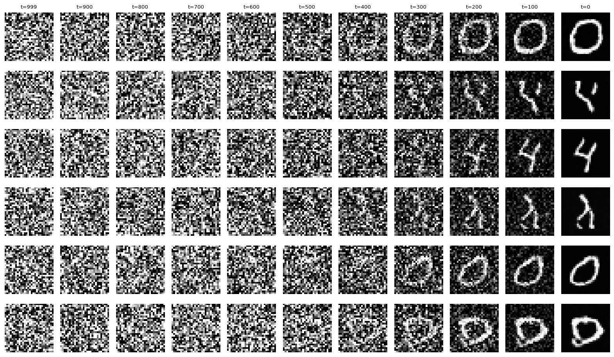
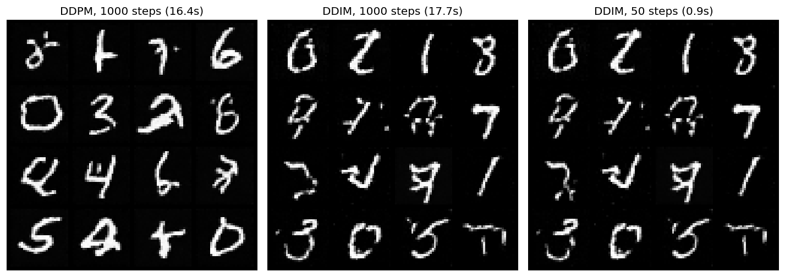
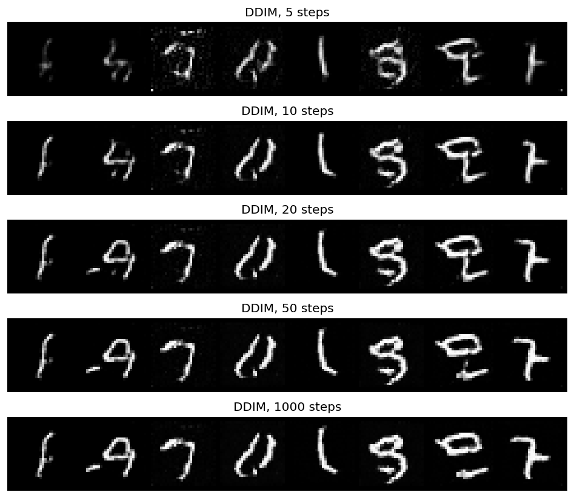

[← All projects](../README.md)

# 8. Diffusion model (DDPM)

A small diffusion model on MNIST, built from scratch. I teach a U-Net to remove noise from images. Then I start from pure static, remove the noise one small step at a time, and a new digit appears. At the end I add DDIM, which uses the same model but needs only 20 to 50 steps.

| | |
| --- | --- |
| Code | [`notebooks/ddpm.ipynb`](../notebooks/ddpm.ipynb) |
| Task | Generative modelling: draw new handwritten digits from random noise |
| Data | MNIST, 60000 train / 10000 test images, 28x28 grayscale, scaled to [-1, 1] |
| Model | Small time-conditioned U-Net, 2.94M params, trained from scratch |
| Noise steps | T = 1000, linear schedule from 1e-4 to 0.02 (paper values) |
| Hardware | Apple Silicon GPU (`mps`), 5 epochs, about 33 min |
| Result | Noise-prediction MSE: 0.0258 train, 0.0276 test |
| Sampling speed | 16 digits: DDPM 1000 steps 16.4 s, DDIM 50 steps 0.9 s, same model |

## The question

The VAE in [project 7](07-variational-autoencoder.md) can make new digits, but they come out blurry. Diffusion models are what Stable Diffusion, DALL-E and Midjourney are built on, and they make sharp images. I wanted to see how the basic version works: how you train a network to "undo noise", and how that turns into a way to make images out of nothing.

## The idea in plain words

Think of a photo slowly turning into TV static.

1. **Forward (no learning).** Take a clean digit. Add a tiny bit of random noise. Do it again, 1000 times. At the end you have pure static. This part is just math.
2. **Reverse (learned).** Train a network to look at a noisy image and guess *which noise* was added. If you know the noise, you can subtract it and get a slightly cleaner image.
3. **Generate.** Start from fresh static that never was a digit. Ask the network to clean it up, one step at a time, 1000 times. What's left at the end is a new digit.

```
FORWARD (fixed):   x_0 ──add noise──► x_1 ──► ... ──► x_1000   (pure static)
REVERSE (learned): x_1000 ──denoise──► x_999 ──► ... ──► x_0   (new digit)
```

## Theory, a little deeper

### The noise schedule

`beta_t` is how much noise step `t` adds. It grows from `0.0001` to `0.02` across 1000 steps. Two helper values come from it:

- `alpha_t = 1 - beta_t`
- `alpha_bar_t = alpha_1 · alpha_2 · ... · alpha_t`, the share of the original image that survives to step `t`

The nice part: you don't have to loop 1000 times to get a noisy image. You can jump straight to any step:

$$x_t = \sqrt{\bar\alpha_t}\,x_0 + \sqrt{1-\bar\alpha_t}\,\epsilon, \quad \epsilon \sim N(0, I)$$

So training is cheap. Pick a random `t`, make `x_t` in one line, done.

### What the network learns

The network does **not** predict the clean image. It predicts the noise `ε` that was mixed in. The loss is plain MSE between the real noise and the guess:

$$\mathcal{L} = \lVert \epsilon - \epsilon_\theta(x_t, t) \rVert^2$$

That's the whole training loop:

```python
t = torch.randint(0, T, (batch,))            # random step for each image
xt, noise = add_noise(x0, t)                  # jump to step t
loss = F.mse_loss(model(xt, t), noise)        # guess the noise
```

### One reverse step

To go from `x_t` to `x_{t-1}`, remove the predicted noise and add back a little fresh noise (paper, Algorithm 2):

$$x_{t-1} = \frac{1}{\sqrt{\alpha_t}}\left(x_t - \frac{\beta_t}{\sqrt{1-\bar\alpha_t}}\,\epsilon_\theta(x_t, t)\right) + \sqrt{\beta_t}\,z$$

On the last step (`t = 0`) no fresh noise is added.

## How I built it

### The network: a small U-Net that knows the time step

Step 900 (almost all noise) needs very different work from step 10 (almost clean). So the network must be told `t`.

- **Time embedding.** Turn the number `t` into a vector with sine and cosine waves, the same trick Transformers use for positions. A small MLP follows.
- **ResBlock.** Two convs with a skip connection. The time vector is added to the feature map in the middle, so every block knows the step.
- **U-Net.** Go down twice, through a middle block, then up twice with skip connections. The output has the same shape as the input, because it *is* the predicted noise.

```
28x28 ─► ResBlock(64) ───────────────────────────► concat ─► ResBlock(64) ─► noise 28x28
           │ down                                     ▲ up
         14x14 ─► ResBlock(128) ─────► concat ─► ResBlock(64)
                   │ down                 ▲ up
                  7x7 ─► ResBlock(256) ─► ResBlock(128)

                  every ResBlock also gets the time embedding of t
```

I couldn't reuse the off-the-shelf U-Net from [project 6](06-unet-segmentation.md), because it has no input for `t`.

### The DDPM wrapper

| Method | What it does |
| --- | --- |
| `add_noise(x0, t)` | Forward process: clean image to step `t` in one shot |
| `loss(x0)` | Random `t`, add noise, predict it, MSE |
| `sample(n)` | Reverse process: start at random noise, denoise 1000 times |

### Training

Adam, learning rate `2e-4`, batch size 128, 5 epochs (about 2350 steps).

## Run it

```bash
uv run --with jupyter jupyter lab notebooks/ddpm.ipynb
```

Run the cells top to bottom. MNIST downloads to `data/`. Weights save to `outputs/ddpm_mnist.pt` (git-ignored). On my Mac (`mps`) training took about 33 minutes.

Already trained? Run sections 1 to 5 and 7, then section 11 (DDIM). It loads the saved weights.

## Results

### Training loss



| Epoch | Train loss | Time so far |
| --- | --- | --- |
| 1 | 0.0666 | 493 s |
| 2 | 0.0324 | 924 s |
| 3 | 0.0285 | 1258 s |
| 4 | 0.0269 | 1591 s |
| 5 | 0.0258 | 1954 s |

The loss starts at about 1.0, which is what you get by guessing zero noise. It drops fast in the first few hundred steps, then flattens. Test loss is 0.0276, very close to train, so the model isn't overfitting.

### Can it clean a test image in one step?

I took 8 test digits the model never saw, noised them to step `t`, then used the predicted noise to guess the clean image in a single jump:

$$\hat x_0 = \frac{x_t - \sqrt{1-\bar\alpha_t}\,\epsilon_\theta(x_t, t)}{\sqrt{\bar\alpha_t}}$$



- **t = 50 and t = 200:** near perfect. Every digit comes back clean.
- **t = 500:** the input looks like pure static to me, yet the model still recovers the 7, 0 and 1. Others come out as blurry guesses (the 2 turns into an 8, the 4s into 9 and 5).
- **t = 800:** just faint smudges.

This is why sampling uses 1000 small steps instead of one big one. One jump from heavy noise is too hard. Many small jumps are easy.

### New digits from pure noise

64 samples, each started from random noise and run through all 1000 reverse steps. No real image was involved.



Many are clear digits: 7s, 0s, 1s, a 6, a 5, a 4. They're sharp, with crisp edges, which is a real step up from the blurry VAE samples. But a fair number are squiggles that only look half like a digit. After only 5 epochs, that's expected.

### Watching a digit appear

Same reverse loop, with a snapshot every 100 steps.



From t = 999 down to about t = 400, it's all static. Somewhere around t = 300 a rough shape shows up. By t = 200 you can tell it's a 0 or a 4. The last 200 steps only clean up the edges. So the big decisions (which digit, where) happen in the middle, and the end is polish.

## DDIM: same model, fewer steps

DDPM walks down all 1000 steps. DDIM jumps, for example 50 steps of 20 levels each, using the same trained U-Net. No retraining.

One DDIM step, from level `t` down to level `s`:

```python
eps = model(x, t)                                  # 1. predict the noise
x0  = (x - (1 - a_t).sqrt() * eps) / a_t.sqrt()    # 2. guess the clean image
x   = a_s.sqrt() * x0 + (1 - a_s).sqrt() * eps     # 3. noise that guess back to level s
```

**Why can it skip?** Training only taught the model "how much noise is in this image at level `t`". It never learned how step `t` connects to step `t-1`. So we can ask it at any levels we want.

**Why is it faster?** Each step is one U-Net call. 50 steps instead of 1000 is 20 times fewer calls.

**Deterministic.** DDIM adds no new random noise, so the same starting noise always gives the same digit.



All three panels start from the same 16 noises.

- **DDPM vs DDIM 1000:** different digits. DDPM adds new random noise at every step, so it ends up somewhere else.
- **DDIM 1000 vs DDIM 50:** the same digits. Skipping steps barely changes the result.
- **Speed:** DDPM and DDIM at 1000 steps both take about 17 s. With 50 steps DDIM takes 0.9 s. The speed comes from fewer steps, not from a faster step.

(The 3 s printed back in section 10 was wrong. The clock stopped before the GPU had finished. The DDIM cells wait for it with `torch.mps.synchronize()`.)



The same 8 noises, decoded with more and more steps. At 5 steps the digits are rough. From 20 steps on they barely change, so 20 steps (50x fewer calls) is enough here.

## What I learned

- The training loop is tiny: random step, add noise, predict noise, MSE. All the cleverness is in the math that lets you jump to any step in one line.
- Predicting the noise, not the image, makes the loss a plain MSE.
- The network must know `t`. Adding a time embedding into every ResBlock is a simple way to do it.
- Sharp samples, unlike the VAE. The price is speed: one image needs 1000 network calls instead of one.
- The digit's shape is decided in the middle of the reverse chain (around t = 300 to 200). The early steps barely change anything you can see.
- One-step denoising from t = 500 already gets the rough digit. That is exactly what DDIM builds on.
- DDIM skips steps because training only used the one-shot jump to `x_t`. Guess the clean image, add back less noise, repeat.
- Time GPU code with a sync. My first DDPM timing said 3 s. The real number was over 70 s.

## Next

1. Train longer (20+ epochs) for cleaner digits.
2. Add self-attention in the bottleneck.
3. Swap the linear schedule for a cosine schedule (Nichol and Dhariwal, 2021).
4. Try other fast samplers (DPM-Solver) and compare at 10 steps.
5. Class-conditional generation: ask for "a 7" on demand, then try classifier-free guidance.

## References

- Ho et al., [Denoising Diffusion Probabilistic Models](https://arxiv.org/abs/2006.11239), 2020
- Nichol and Dhariwal, [Improved Denoising Diffusion Probabilistic Models](https://arxiv.org/abs/2102.09672), 2021
- Song et al., [Denoising Diffusion Implicit Models (DDIM)](https://arxiv.org/abs/2010.02502), 2020
- Lu et al., [DPM-Solver](https://arxiv.org/abs/2206.00927), 2022
- Weng, [What are Diffusion Models?](https://lilianweng.github.io/posts/2021-07-11-diffusion-models/), 2021
- Rombach et al., [High-Resolution Image Synthesis with Latent Diffusion Models](https://arxiv.org/abs/2112.10752), 2022
